# release-ops-pipeline

A small but complete **CI/CD release pipeline with live-ops monitoring**, built in my IT-admin homelab.
Every push to `main` is linted, tested, built, deployed and health-checked automatically by **Jenkins**.
A **Bash** deploy script switches releases atomically and **rolls back on its own** when a release is unhealthy,
every deployment is recorded in **PostgreSQL**, and a standalone **Python** log scanner raises alerts
when it finds critical error patterns in the logs.

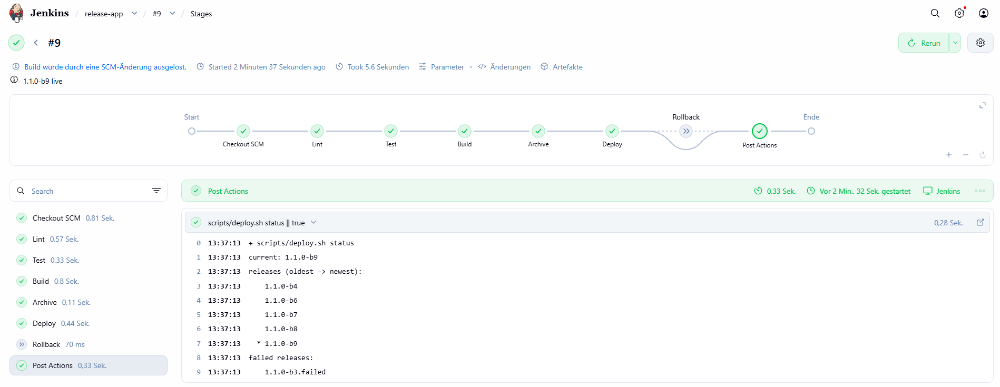

---

## Table of Contents

- [Overview](#overview)
- [Architecture / Setup](#architecture--setup)
- [Tech Stack](#tech-stack)
- [Repository Structure](#repository-structure)
- [Steps Taken](#steps-taken)
- [Challenges & Solutions](#challenges--solutions)
- [Key Learnings](#key-learnings)
- [Screenshots](#screenshots)

---

## Overview

| | |
|---|---|
| **Goal** | Build, deploy, verify and roll back a sample web app without manual steps – and notice problems before users report them |
| **Trigger** | `git push` to `main` (Jenkins polls GitHub every ~2 minutes) |
| **Deploy strategy** | One directory per release + atomic `current` symlink switch, health check after every switch |
| **Rollback** | Automatic when the health check fails, manual on demand via a Jenkins parameter (< 1 s) |
| **Audit trail** | Append-only `deploy_history` table in PostgreSQL (timestamp, version, status, duration, previous release, trigger) |
| **Monitoring** | Python log scanner as hardened systemd timer, alerts via console/journal (e-mail ready) |
| **Host** | Debian 13 VM `ops01` on my Proxmox VE host from [proxmox-homelab](https://github.com/rkraus-tech/proxmox-homelab) |

**What it proves in practice (tested end to end):**

- Commit `release: 1.1.0` → deployed automatically in **5.4 s**, no click in Jenkins
- Faulty commit (unhealthy health endpoint) → detected after deploy, **automatic rollback in 10 s**, build marked red, users never saw the broken version
- Fix via `git revert` → green again
- Manual rollback with one click → previous release live in **< 1 s**
- The log scanner found the failed deployment in the production log and raised an **ALERT**

---

## Architecture / Setup

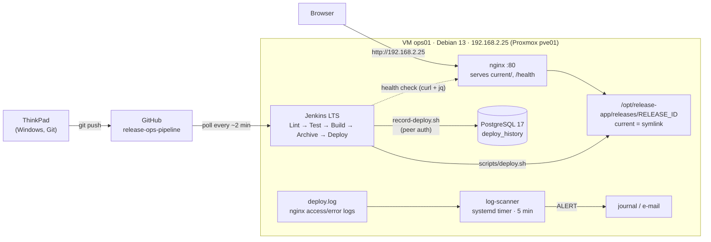

| Component | Details |
|---|---|
| Hypervisor | Proxmox VE 9.2 on HP EliteDesk 800 G3 Mini (`pve01`) |
| VM | `ops01` (VM ID 125 = IP .25), Debian 13, 2 vCPU (type `host`), 4 GiB RAM, 32 GiB disk (VirtIO SCSI, discard), static IP 192.168.2.25, headless, root login disabled (sudo) |
| CI/CD | Jenkins LTS (Java 21) as systemd service under the unprivileged `jenkins` user, port 8080, LAN only |
| Web server | nginx serving `/opt/release-app/current`, `/health` endpoint, dedicated app logs |
| Database | PostgreSQL 17, listening on localhost only, peer authentication (no passwords) |
| Monitoring | `log-scanner.service` + `log-scanner.timer` (DynamicUser, read-only system), logrotate for deploy logs |

### Release layout on the server

```
/opt/release-app/
├── releases/
│   ├── 1.1.0-b6/
│   ├── 1.1.0-b7/
│   ├── 1.1.0-b8/
│   ├── 1.1.0-b9/          ← newest 5 releases are kept
│   └── 1.1.0-b3.failed/   ← failed release kept for analysis, never a rollback target
└── current -> releases/1.1.0-b9
```

---

## Tech Stack

### Jenkins (CI/CD)
- Declarative **pipeline as code** (`jenkins/Jenkinsfile`), job = "Pipeline script from SCM"
- Stages: **Lint** (`bash -n` + ShellCheck) → **Test** (Python unit tests) → **Build** → **Archive** (artifact + SHA-256, fingerprinted) → **Deploy** / **Rollback**
- Parameters `ACTION` (deploy/rollback) and `ROLLBACK_TO`; exit codes of the deploy script mapped to clear build results
- `disableConcurrentBuilds`, timestamps, 15-minute timeout, build retention; Poll SCM instead of a public webhook

### Bash (build, deploy, rollback)
- `scripts/build.sh` – stamps version/build/timestamp into the app, quality gates (no leftover placeholders, valid JSON), creates `tar.gz` + checksum
- `scripts/deploy.sh deploy | rollback | status` – `flock` lock, checksum verification, atomic unpack + symlink switch, health check that verifies the **exact** version and build, automatic rollback, cleanup, structured logging, meaningful exit codes (0/1/2/3)
- `scripts/record-deploy.sh` – writes the result to PostgreSQL via psql variables (SQL-injection safe); a database outage never blocks a deployment
- All scripts: `set -Eeuo pipefail`, ShellCheck-clean

### SQL (PostgreSQL)
- `sql/001_roles_and_database.sql` – group roles `deploy_writer` (INSERT/SELECT) and `deploy_reader` (SELECT), login roles `jenkins` and `robert`, `CONNECT` revoked from `PUBLIC`
- `sql/002_deploy_history.sql` – append-only audit table with `CHECK` constraints and index, created in a transaction
- `sql/reports.sql` – last deployments, success rate (30 days), average/max duration per action and status, currently live release

### Python (log scanner)
- `python/log_scanner.py` – standalone CLI, **standard library only** (Python 3.11+)
- Rules in `python/rules.toml` (regex + severity + file filter), alert on any CRITICAL or ≥ 3 WARNINGs
- State file: only new lines per run, detects log rotation/truncation/inode reuse, ignores half-written lines
- Console + e-mail alerting (SMTP/STARTTLS, credentials only from environment), Nagios-style exit codes (0 OK, 1 WARNING, 2 ALERT, 3 UNKNOWN)
- 26 unit tests with real log lines from this project, executed in every pipeline run

### Infrastructure
- Proxmox VE, Debian 13, nginx, systemd (service + timer hardening), logrotate, Git/GitHub

---

## Repository Structure

```
release-ops-pipeline/
├── app/                      sample app: index.html + health.json templates, VERSION
├── scripts/                  build.sh, deploy.sh, record-deploy.sh
├── jenkins/                  Jenkinsfile
├── sql/                      roles/database, deploy_history table, reports
├── python/                   log_scanner.py, rules.toml, samples/, tests/
├── config/
│   ├── systemd/              log-scanner.service, log-scanner.timer
│   └── logrotate/            release-app
├── screenshots/              README images
└── docs/notes.md             detailed build log of every phase
```

---

## Steps Taken

**1. Planning & repository** – Decided on a dedicated Debian VM on Proxmox with native Jenkins (instead of Docker on the laptop) and PostgreSQL (instead of SQLite). Created the repo with `.gitattributes` forcing LF for all Linux files and a `.gitignore` that keeps secrets and unredacted screenshots out.

**2. Pipeline VM** – Created VM `ops01` (VM ID matches the IP), installed a minimal headless Debian 13 (no root password, sudo only), configured a static IP via `/etc/network/interfaces`, fixed DNS that was overwritten by dhcpcd, installed the QEMU guest agent, enabled "start at boot" and switched to SSH.

**3. Jenkins & deploy target** – Installed Java 21 and Jenkins LTS from the signed Jenkins apt repository (`signed-by` keyring), unlocked it, created a personal admin account. Installed nginx with a dedicated site (`root` = `current` symlink, `/health` endpoint, separate logs) and created the release directory owned by `jenkins`.

**4. Build & deploy scripts** – Wrote `build.sh` (versioned artifact + checksum) and `deploy.sh` (lock, checksum, atomic switch, health check, automatic rollback, cleanup, exit codes). Tested as the `jenkins` user: two deployments, an intentionally broken release that was rolled back automatically, and a manual rollback.

**5. Deploy history in SQL** – Installed PostgreSQL 17 (localhost only), created group/login roles with least privilege and peer authentication, an append-only `deploy_history` table and report queries. Connected the deploy script through the `record-deploy.sh` hook.

**6. Jenkins pipeline** – Wrote the declarative `Jenkinsfile`, created the job from SCM, cleaned up test data before go-live, and tested the full cycle: automatic deploy on commit, faulty commit with automatic rollback, `git revert`, manual rollback via parameters.

**7. Log scanner & alerting** – Built the Python scanner with TOML rules, state handling, alert policy, e-mail support and 26 unit tests. Added a Test stage to the pipeline, installed the scanner as a hardened systemd service + timer and configured logrotate for the deploy log.

**8. Documentation** – Collected all decisions and problems in [`docs/notes.md`](docs/notes.md), redacted screenshots, wrote this README.

---

## Challenges & Solutions

| Challenge | Root cause | Solution |
|---|---|---|
| DNS stopped working after the switch to a static IP (`Temporary failure in name resolution`, while pinging the router by IP worked) | `dhcpcd` still runs at boot for IPv6 and rewrote `/etc/resolv.conf` without an IPv4 nameserver. The first fix (`nohook resolv.conf`) silently failed because of a typo (`nohohook`) | Diagnosed with the file header, `tail` and `pgrep`; corrected the option, wrote `resolv.conf` manually, verified after a reboot |
| Bash scripts written on Windows | CRLF line endings break Bash (`$'\r': command not found`); Git on Windows does not store the executable bit | `.gitattributes` with `eol=lf`, `git update-index --chmod=+x`, verified with `git check-attr` and `git ls-files -s` |
| JSON/VERSION files rejected | Windows PowerShell 5.1 writes UTF-8 **with BOM** | Wrote files with `[IO.File]::WriteAllText` (UTF-8 without BOM) |
| Release directory unreadable for nginx (potential 403) | The build stages files in a `mktemp -d` directory (mode 700) and `tar` stores that mode | `deploy.sh` normalizes permissions after unpacking – never trust permissions inside an artifact |
| First Jenkins build would collide with test releases | Jenkins build numbers start at 1 like the manual tests | Removed test releases and truncated the history (as DB admin) before go-live |
| Jenkins did not start a build after a commit | The commit was never pushed; the Git polling log showed "already built" | Always `git push` + `git status` ("up to date with origin/main"); the polling log shows what Jenkins really sees |
| Parameters missing in Jenkins | Parameters/triggers from a Jenkinsfile are registered only after the first run | First run with "Build Now", afterwards "Build with Parameters" |
| Duplicate alerts every 5 minutes would be useless | A scanner without memory re-reads the whole log | State file with offsets, rotation/inode-reuse detection, atomic writes – one alert per incident |
| Empty journal for the scanner service | Only members of `adm`/`systemd-journal` can read system logs | `sudo journalctl -u log-scanner.service` |

---

## Key Learnings

- **Build once, deploy many** – the exact artifact that was built and checksummed is the one that goes live.
- **A health check must verify the right version**, not just "the page answers" – otherwise a stale release passes.
- **Atomic switches + kept releases make rollbacks boring** – a symlink change instead of a rebuild.
- **Exit codes are an interface** between scripts, Jenkins, systemd and monitoring tools; design them on purpose.
- **Least privilege everywhere**: Jenkins as its own user, release directory owned by `jenkins` (no sudo for deployments), DB roles that can only append, scanner as a throw-away `DynamicUser` with read-only access.
- **The best password is the one that does not exist** – peer authentication for local services; for remote services secrets belong in a credential store, never in the repo.
- **An audit log must be append-only** – otherwise it proves nothing.
- **The watchdog must not depend on what it watches** – the log scanner runs via systemd, not inside Jenkins.
- **Verify, don't assume**: check config after a reboot, read the actual file content, read the polling log – most problems in this project were found that way.
- **Fix forward with `git revert`** instead of rewriting shared history.

---

## Screenshots

### Repository & VM

| | |
|---|---|
| 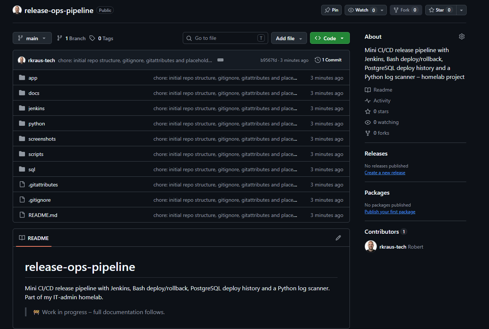 | 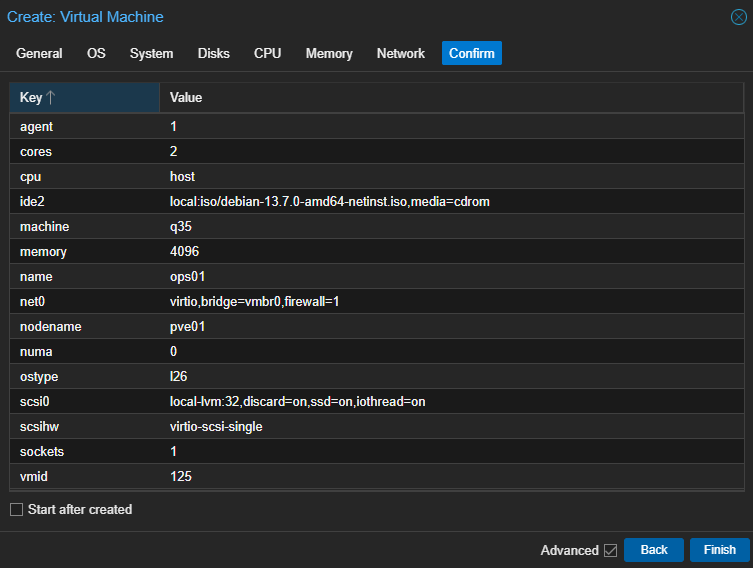 |
| Repository structure after the initial setup | Proxmox VM `ops01`: 2 vCPU (host), 4 GiB RAM, 32 GiB VirtIO disk |
| 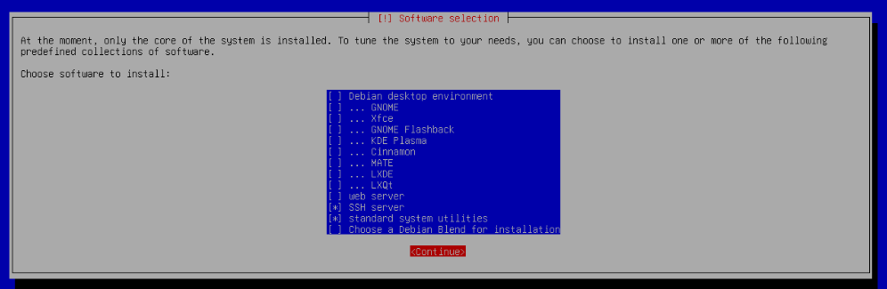 | 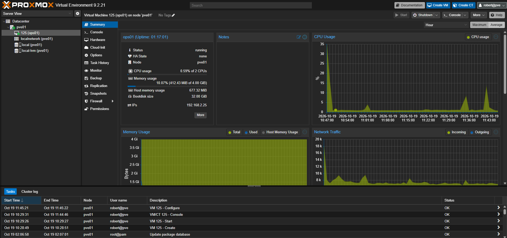 |
| Minimal headless install: SSH server + standard utilities only | VM running with static IP reported by the QEMU guest agent |

### Deploy & rollback (Bash)

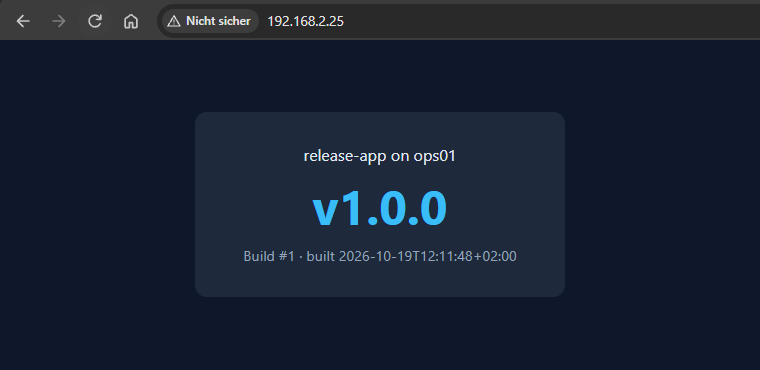

*First release served by nginx via the `current` symlink.*

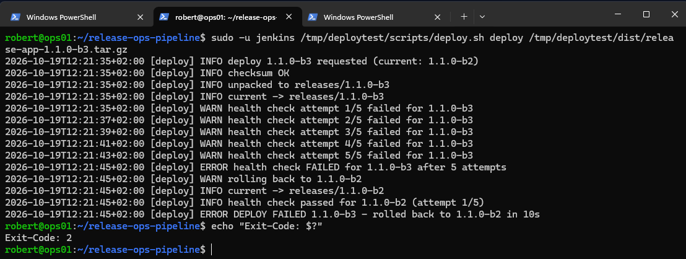

*Broken release: five failed health checks, automatic rollback to the previous release, exit code 2.*

### Deploy history (SQL)

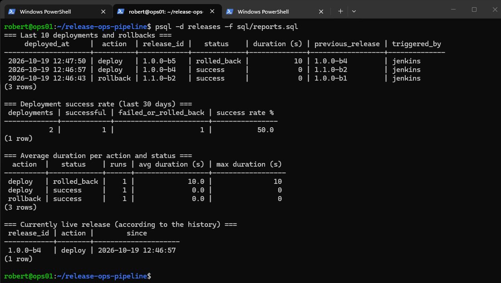

*`sql/reports.sql`: last deployments, success rate, durations and the currently live release.*

### Jenkins pipeline

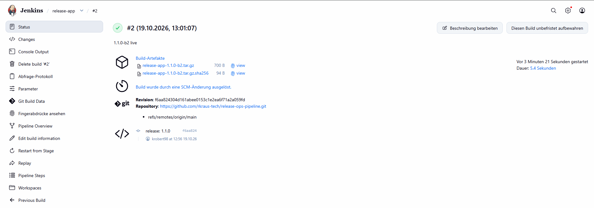

*Build #2 started automatically by the commit `release: 1.1.0` – artifacts archived, 5.4 s total.*

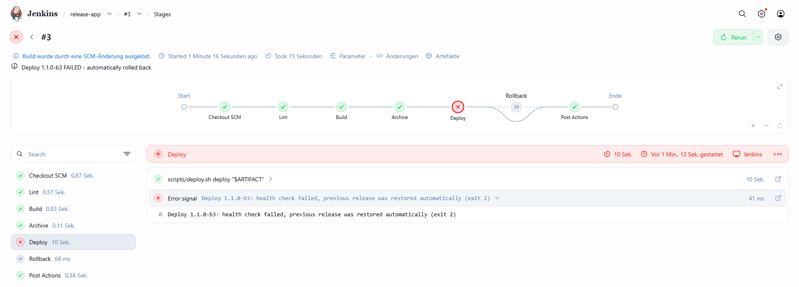

*Build #3: faulty commit caught in the Deploy stage, previous release restored automatically.*

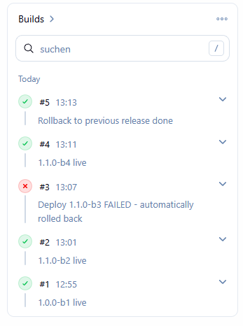

*Initial deploy, update via commit, caught failure, fix via revert, manual rollback.*


*Final pipeline: Lint → Test → Build → Archive → Deploy, status of all releases in the post actions.*

### Log scanner (Python)

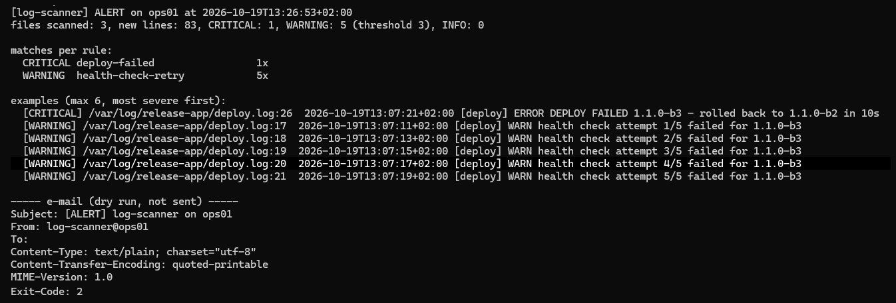

*Scan of the real production logs: the failed deployment raises an ALERT (e-mail shown as dry run).*

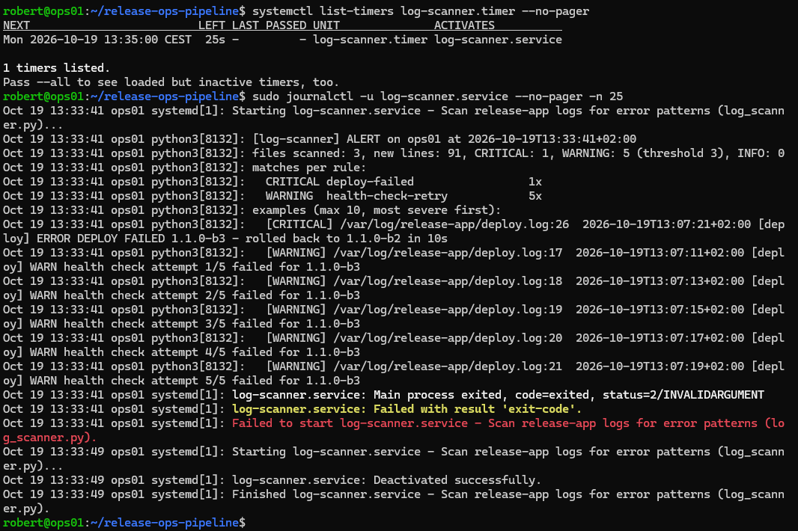

*Scanner as systemd timer: first run alerts on the incident, the next run only checks new lines.*

---

*Part of my IT-admin homelab series. Detailed build log: [`docs/notes.md`](docs/notes.md).*
